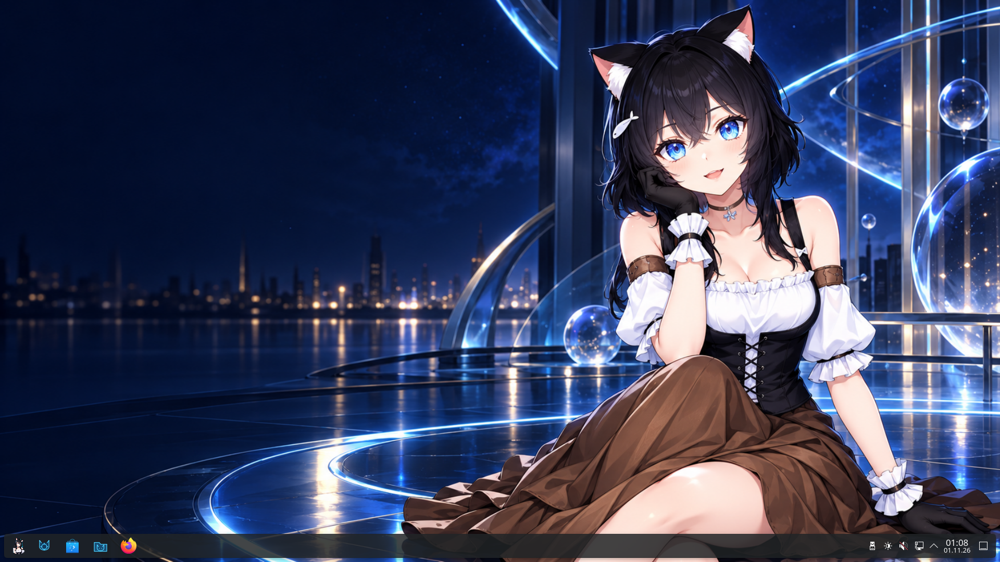
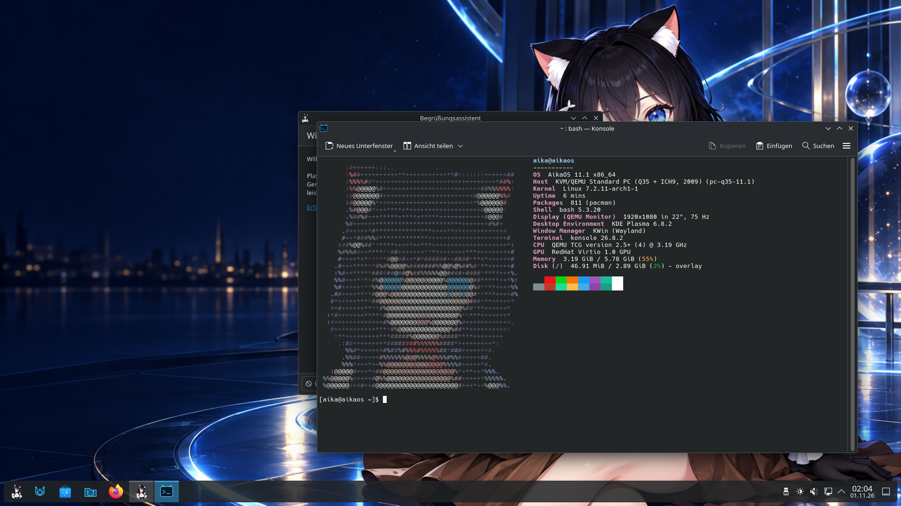
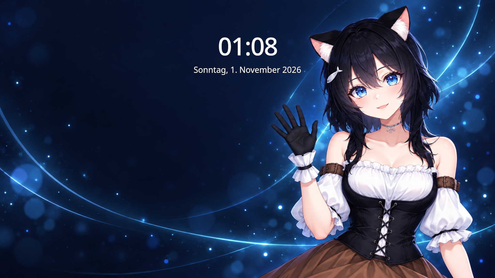
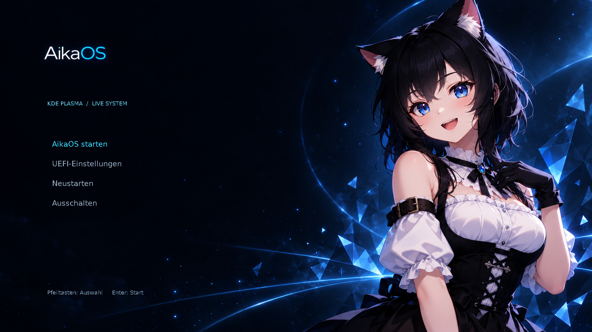

<h1 align="center">AikaOS</h1>

<strong>An Arch-based KDE Plasma desktop with an Aika identity and offline installation.</strong>

11.1 release preparation · x86_64 · Calamares · KDE Plasma · Custom GRUB

<a href="releases/11.1/RELEASE_NOTES.md">11.1 release notes</a> · <a href="docs/INSTALLING.md">Install with Rufus</a> · <a href="docs/VERIFYING.md">Verify an image</a> · <a href="docs/INSTALLER.md">Build from source</a> · <a href="https://github.com/emiliaplays/AikaOS/issues">Report a bug</a>

## Meet AikaOS 11.1

AikaOS combines an Arch Linux base with KDE Plasma, a midnight-blue desktop and a consistent Aika mascot. Version 11.1 adds an Aika-themed offline Calamares installer and password-protected installed-user defaults.

**Publication pending:** this branch prepares the first installable release. The [published Beta 1](https://github.com/emiliaplays/AikaOS/releases/tag/v11.1-beta.1) remains available as the historical live-only image.

- **KDE Plasma on Wayland** with a dark desktop and selected Aika-themed icons.
- **Aika branding** for the launcher, system logo, avatar, desktop wallpaper, and lock screen.
- **Custom GRUB artwork** with BIOS and UEFI boot support.
- **Fastfetch 2.70.0** preinstalled with a color ASCII portrait, plus compact and full-character variants.
- **Everyday tools** including Firefox, Dolphin, Konsole, Kate, and NetworkManager.
- **Offline Calamares installation** to ext4, with no swap or an automatically enabled swap file.
- **Installed-account defaults** with password-based login/sudo, a locked root account and SSH disabled by default.

## Download and boot

The 11.1 release image has the distinct filename **`aikaos-11.1-stable-x86_64.iso`**. Its single-file SourceForge download will be linked from the official GitHub release after final acceptance. Checksums, package inventory, build metadata and a verifiable build-provenance bundle accompany it.

Verify the image and write it to an **8 GB or larger USB drive using [Rufus](https://rufus.ie/en/)**. Choose **ISO Image mode** if offered. Boot the **UEFI** USB entry with Secure Boot disabled. USB writing erases the selected USB drive; erase-disk installation separately erases the selected target disk. Follow the [installation guide](docs/INSTALLING.md).

| Release detail | Value |
| --- | --- |
| Image | `aikaos-11.1-stable-x86_64.iso` |
| Status | **Release candidate — final image acceptance in progress** |
| Architecture | x86_64 |
| Live account | `aika` — automatic login, no password, passwordless `sudo` |
| Session defaults | German (`de_DE.UTF-8`), German keyboard, Europe/Berlin timezone |
| Persistence | Live changes are held in RAM and reset after reboot |
| Installer | Aika-themed offline Calamares 3.4.3 |
| Validated installation scope | Fresh x86_64 UEFI installation to a dedicated disk, ext4 |

English documentation does not change the German session defaults. Calamares transfers the Aika identity/artwork and replaces the open live account with the user you create. See [maintenance](docs/MAINTENANCE.md) for Arch package updates and AikaOS-specific configuration changes.

## A closer look

| Fastfetch | Lock screen |
| --- | --- |
|  |  |

## Validation and scope

The corrected installer profile passed physical installation, a full kernel/microcode update and reboot, timed S3 suspend/resume, and a complete KVM swap-file installation. That KVM installation passed **29/29** installed checks and **11/11** extended checks, including normal password lock/unlock. The final stable-channel image receives a separate acceptance pass.

Read the [hardware report](docs/HARDWARE_VALIDATION.md), [update/suspend report](docs/UPDATE_VALIDATION.md), [swap installation report](docs/SWAP_VALIDATION.md) and [known issues](docs/KNOWN_ISSUES.md). Secure Boot, legacy-BIOS installation, dual boot, encryption, hibernation and recovery are outside the validated release scope. Earlier TCG graphics failures remain documented separately from the successful KVM run.

## Source and contributions

The repository contains the live profile, artwork, selected icons, Fastfetch configurations, and a [reference build procedure](docs/BUILDING.md). Build in an Arch Linux environment; the ISO is a release download, not a Git blob.

The [installer build guide](docs/INSTALLER.md) covers development/stable channels and the pinned Calamares recipe. The [release procedure](docs/RELEASING.md) separates a candidate build, verification, acceptance and publication. The original [Beta 1 validation](docs/VALIDATION.md) and image are preserved.

Read [CONTRIBUTING.md](CONTRIBUTING.md) for useful bug reports and changes. For security concerns, see [SECURITY.md](SECURITY.md).

## Credits and licensing

Built with [Arch Linux](https://archlinux.org/), [Archiso](https://gitlab.archlinux.org/archlinux/archiso), [KDE Plasma](https://kde.org/plasma-desktop/), [GNU GRUB](https://www.gnu.org/software/grub/), and [Fastfetch](https://github.com/fastfetch-cli/fastfetch).

Build scripts and profile modifications use **GPL-3.0-or-later**. Upstream files and bundled packages retain their own licenses. Artwork and mascot branding have separate provenance and are not covered by the software license: see [ARTWORK.md](ARTWORK.md) and [THIRD_PARTY.md](THIRD_PARTY.md).
