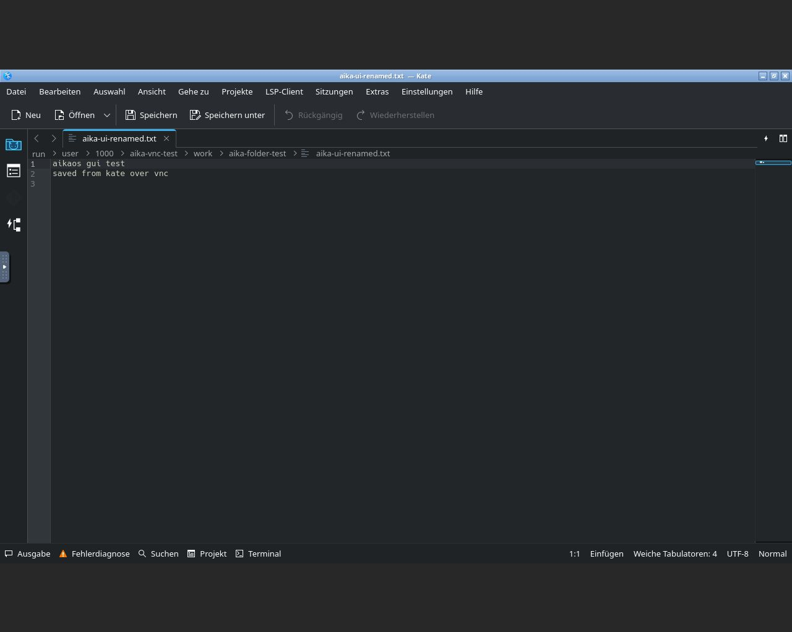

# Installed-system hardware validation

Physical test performed by the maintainer and audited over SSH on 2026-11-01. This is separate from the [VM installation report](INSTALLER_VALIDATION.md). Raw diagnostic logs, account names, network addresses and credentials are not published.

## Test system

| Component | Observed configuration |
| --- | --- |
| CPU | Intel Core i7-2600K, 4 cores / 8 threads |
| GPU | AMD Radeon RX 580 / Polaris, amdgpu + radeonsi |
| RAM | Approximately 32 GiB |
| Storage | 111.8 GiB SATA SSD; 512 MiB FAT32 EFI partition and ext4 root |
| Boot/session | UEFI, installed root on `/dev/sda2`, KDE Plasma Wayland |
| Software | AikaOS 11.1 Development, Linux 7.2.11-arch1-1, Plasma 6.8.2, Mesa 26.2.6 |

The installed disk and firmware boot entries were inspected without changing partitions. No installation medium was mounted. The exact original ISO checksum was not recorded on the test PC.

## Initial results

All **24 original installed-system acceptance checks passed**, including password-protected sudo, locked root, removal of live defaults, boot files, Aika branding, the exact supplied Fastfetch configuration, private user home, enabled desktop/network services and disabled SSH autostart. SSH was running manually for this audit.

There were no failed system/user services or coredumps at the initial checkpoint. KSplash returned `Result=success` and exit status 0. KWin reported active hardware-accelerated OpenGL ES rendering on the Radeon GPU, with no VM-specific graphics overrides.

Ten of eleven additional checks passed: fstab validation, desktop package presence, Fastfetch execution, KWin and audio graph responses, Aika assets, DNS, HTTPS, package database consistency and a disposable user-home write/read/fsync test. The remaining package-file check exposed the microcode-image issue described below.

The maintainer separately confirmed that Firefox/web browsing, audio playback and screen locking/unlocking all worked. These are human-observed functional results, not claims inferred from an active process.

## Microcode package-file correction

`pacman -Qk` found exactly two missing package-owned files: `/boot/amd-ucode.img` and `/boot/intel-ucode.img`. Archiso clears `/boot` in its compressed root, and the installer previously restored the kernel but not these two images.

This did **not** mean early CPU microcode was absent: `lsinitcpio --early` found `GenuineIntel.bin` inside the installed initramfs, and the kernel reported a successful early microcode update. Arch's [mkinitcpio microcode hook](https://archlinux.org/news/mkinitcpio-hook-migration-and-early-microcode/) embeds that firmware in the combined initramfs.

A full repository synchronization/upgrade transaction found no pending version upgrades and reinstalled both signed microcode packages. Both default and fallback initramfs images were regenerated successfully. GRUB configuration was backed up, regenerated and checked with `grub-script-check`; its default and fallback entries now include both package-provided images. No partition or firmware boot entry was changed.

Source commit `da8120f` preserves the original package-provided images in the installer filesystem before Archiso cleanup, verifies their checksums and restores them to the installed `/boot`. It also adds a 25th acceptance check and a build-time payload check. The [complete clean ISO build passed](https://github.com/emiliaplays/AikaOS/actions/runs/41336768728), including its microcode payload check. The large temporary CI artifact was deleted after its verified local download.

| Corrected development image | Value |
| --- | --- |
| Source | `da8120f6ed49978433aaf4533ddfcac39ed28c1a` |
| Filename | `aikaos-11.1-installer-dev-x86_64.iso` |
| Bytes | 2,328,059,904 |
| SHA-256 | `d2f0abcf3396ebc8e6ce8d3817f703b1e0c30dac1f036622a50fd6abb5effe3b` |

The downloaded ISO was copied to the test PC and its complete SHA-256 was verified again. Its ISO and compressed root were mounted read-only. Both preserved microcode payloads passed their manifest checks, matched the repaired official package files and survived the exact offline `install -m 0644` copy operation into a disposable directory. Both mounts were removed afterwards. This is targeted payload/copy validation, **not another full installation from this corrected image**.

## Repair and controlled-reboot results

Before the controlled reboot, all eleven extended checks passed, including the complete `pacman -Qk` file check. The expanded installation check passed **24 of 25** checks. The remaining raw result was `sshd_disabled=false`: the maintainer intentionally enabled SSH autostart for remote testing after the initial audit. That user-selected setting was preserved; it is not evidence that the installer enables SSH by default. No system/user service failures or coredumps were present, and KSplash completed successfully.

One controlled reboot then returned to SSH automatically with the same host key and a new boot ID. The root filesystem was still the installed ext4 disk with no Archiso boot parameters. Early Intel microcode updated from revision `0x28` to `0x2f`. Boot files, GRUB theme, account policy, Aika assets and the exact supplied Fastfetch configuration remained intact.

After reboot the installation check again passed **24 of 25**, with only the intentional SSH-autostart difference. Ten of eleven extended checks passed. `kwin_responds` was false because the physical seat remained at the SDDM greeter without a logged-in Plasma session. This checkpoint does not claim a successful post-reboot physical desktop login. There were no failed system/user services or coredumps; package database and file checks, DNS, HTTPS, audio graph response and a disposable user-home write/read/fsync test passed.

## Remote application smoke tests

After the reboot, the maintainer reported that this GPU no longer produced a physical picture and already had known core problems. The tests therefore used a **separate CPU-rendered X11/Openbox session**, accessed through password-protected, loopback-only TigerVNC and an SSH tunnel. This was not the normal Plasma Wayland session and did not validate the GPU, physical display, screen locking or the complete Plasma desktop.

Actual GUI interactions verified:

- Konsole opened and accepted keyboard input.
- Kate created and saved a two-line test document. An independent filesystem read confirmed the exact saved bytes.
- Dolphin renamed the file, created a folder and moved the file through its graphical interface. The new path and unchanged contents were independently verified.
- Opening that moved document in Dolphin launched Kate through the normal file association and displayed the saved text.
- Firefox loaded `https://archlinux.org/` without a certificate warning. Its `about:support` page reported **WebRender (Software)** and Mesa llvmpipe.

The isolated session logged missing accessibility-registry and KDE job-server services. File operations and application opening still succeeded; those warnings are retained as test-fixture limitations. Firefox used a disposable profile, and software-rendering variables applied only to this temporary session. No global graphics override was installed.

The VNC session, SSH forward, local proxy, temporary credentials/profile and uploaded ISO were removed afterwards. Only the eight packages added for this test were uninstalled; a final package-file check passed and no system services were failed. The temporary sleep inhibitor was released. The GRUB backup and private diagnostic reports were retained locally. SSH autostart remained enabled at the maintainer's request.

## Graphics messages retained for investigation

The initial boot logged 463 amdgpu `Unsupported screen format RA24` messages in a three-second burst during graphical startup. The desktop subsequently used accelerated rendering, and the maintainer reported no visible failure during the functional checks. Plasma also logged screen-geometry warnings during the session.

The next audited graphical boot had zero RA24 messages, and the controlled-reboot checkpoint also had zero. The latter remained at the greeter, so these counts do not establish a repeatable graphics fix. The only kernel error at those later checkpoints was the old Intel platform's unsupported TDX capability message.

Similar RA24 errors are tracked in the [upstream KDE report](https://bugs.kde.org/show_bug.cgi?id=524476), where developers attribute the reported problem to amdgpu. That report involves different hardware; it does not establish that this test has the identical root cause. The maintainer's report of defective GPU hardware further limits conclusions: a healthy-GPU comparison is still required, and no claim is made that every earlier graphics warning was caused by that defect.

## Remaining checks

Installed-disk reboot, package integrity, core services and the separate remote application tests are verified. Normal post-reboot Plasma login, physical graphics and repeat lock/unlock still need testing with a working GPU. Earlier user-confirmed browsing/audio/lock tests remain useful evidence, but do not replace that repeat check.

Automatic standby occurred during the initial SSH audit. The subsequent recovery had a different boot ID and therefore does **not** prove successful suspend/resume. Suspend/resume remains unverified. Accelerated virtualization, BIOS installation, dual boot, encryption and recovery also remain untested. The earlier TCG VM graphics failures remain recorded in the [VM report](INSTALLER_VALIDATION.md). This remains a development build, not stable-release approval.
