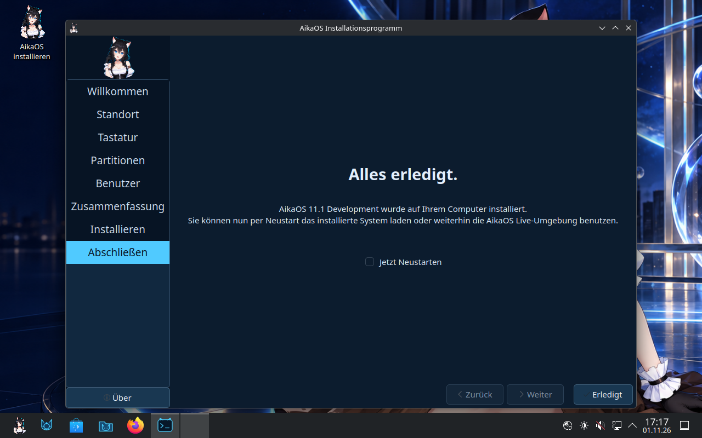
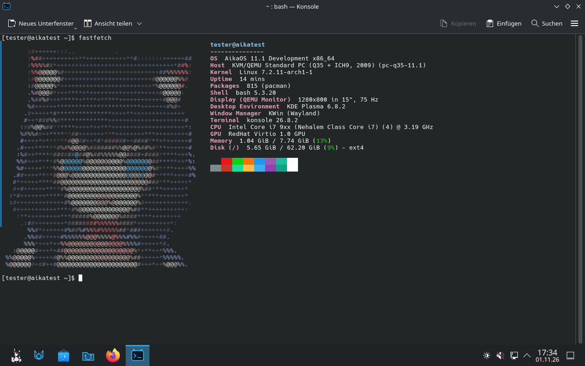
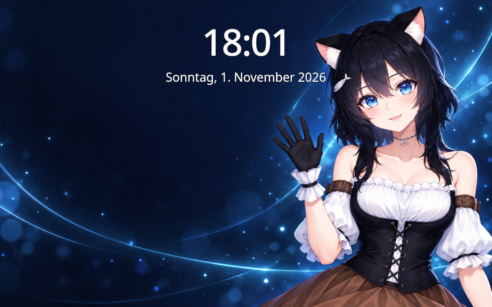
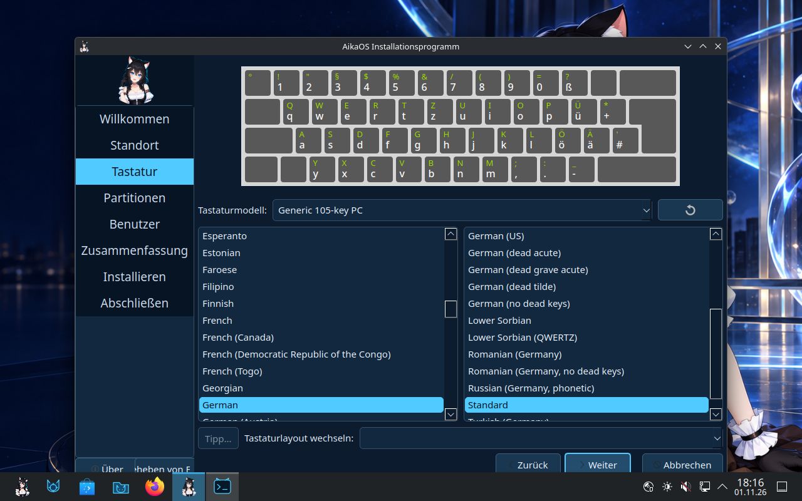
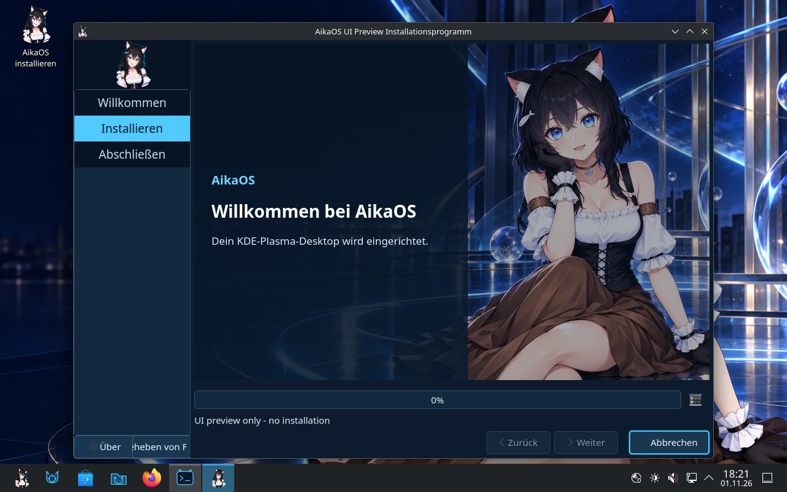

# Installer development validation

Development checks on 2026-11-01. This report is separate from the [published beta validation](VALIDATION.md). It is not stable-release approval.

## Clean baseline rebuild

The first clean build of the published repository failed because four prepopulated Arch artwork paths collided with the `filesystem` package. Commit `a631d6040233b7c05e7c5e6f30b496e4c5f2c4d4` moves these overrides into AikaOS-owned paths and applies them after package installation. It also fixes the wrapper's handling of Archiso 92's already-removed customization hook and emptied root `/boot`.

The complete fresh rebuild then passed, including package installation, initramfs generation, root filesystem compression, SHA-512 verification and GRUB hybrid packaging.

| Image | Bytes | SHA-256 |
| --- | ---: | --- |
| Clean baseline rebuild | 2,315,489,280 | `b1033593bf618a4d4e46ae459cf18c0429a2f193ff0b24986c10917312168e27` |
| First installer development build (`071b04a`) | 2,313,517,056 | `68d9bba0329954dc6f8eb745d7809f817c2cb128470d83e050bd001e5d43a0a4` |
| Banner-corrected development build (`bba059b`) | 2,313,582,592 | `c8a4d93ac0e1d50baef59aeef389f9397d9b67424d8168e36ae866262a0b47c4` |
| Microcode-corrected development build (`da8120f`) | 2,328,059,904 | `d2f0abcf3396ebc8e6ce8d3817f703b1e0c30dac1f036622a50fd6abb5effe3b` |

The baseline ISO booted through its own UEFI/GRUB path into KDE Plasma Wayland without graphics overrides. Fastfetch's supplied configuration hash matched the source, the Arch-logo PNG alias matched the Aika logo, HTTPS connectivity worked, and no system services failed. The initial run had no coredumps, but KRunner and KSplash exceeded their startup timeouts under TCG emulation. KRunner subsequently started successfully with its unchanged timeout.

A second boot reproduced the KSplash timeout. Switching away from the graphical VT during Plasma startup caused repeated `plasmashell` crashes while it reported no available output. Returning to the graphical VT and restarting Plasma restored the desktop. This recovery does not erase the failure. That console-switch case remains a known issue requiring further investigation, including hardware-accelerated VM or physical-hardware comparison.

## Installer build and configuration

- Calamares 3.4.3 was built from the pinned official source archive.
- Fourteen module configurations passed the upstream release's JSON schemas.
- Job ordering, installation confirmation and installed-account defaults passed semantic checks.
- Invalid/root installation targets were rejected before any target command ran.
- The complete installer ISO build passed on a disposable Arch Linux CI container; the downloaded ISO matched its SHA-256 sidecar.
- [Build run](https://github.com/emiliaplays/AikaOS/actions/runs/41315690259). The large temporary artifact was removed after a verified local download.
- The [final clean development build](https://github.com/emiliaplays/AikaOS/actions/runs/41329032236) also passed; its downloaded image matched the checksum above. The large temporary artifact was removed after verification. No stable release was published and the existing Beta 1 image was preserved.

## End-to-end VM installation

**The complete installation and a subsequent installed-disk boot succeeded.** This establishes the basic offline installation path; it does not establish stable-release readiness.

The installation used commit `5225553` and image SHA-256 `dc12bbd0004d14c266228aca207d01f3c388ac156dc7e1f0b749ea8fb50e1167` (2,313,541,632 bytes). All 33 Calamares jobs completed successfully, including filesystem copy, account creation, both initramfs images, UEFI GRUB, fallback EFI loader and a new package keyring. The complete installation log was retained locally.

The test used QEMU TCG, four virtual CPUs, initially 6 GiB RAM, a blank 64 GiB virtio disk and a separate UEFI variable store. Only virtual disks were attached. Hardware virtualization is disabled on the host. The test disk contains a 512 MiB FAT32 EFI partition and an ext4 root partition; swap and encryption were not selected. An absolute USB tablet was added to correct inaccurate pointer coordinates in the test viewer.

After shutdown, the ISO was detached. QEMU's block-device inventory confirmed there was no attached ISO. The installed disk booted through Aika GRUB to the themed SDDM login. A new user logged in using its password and reached KDE Plasma Wayland, with Aika wallpaper, icons and the supplied Fastfetch portrait.

### Installed-system checks

The initial read-only acceptance check passed 21 of 22 checks. The remaining check detected a failed user service: KSplash exceeded its unchanged 40-second startup timeout. No system services failed and no coredumps were present at that checkpoint. The failure was retained, not reset to make the report pass.

Verified results:

- Installation state complete; root mounted from `/dev/vda2`, with no Archiso command-line parameters.
- Exactly one normal user, a set user password, locked root, private home directory and Aika SDDM avatar.
- `sudo` required the user's password. Live passwordless sudo, automatic login, live SSH configuration and temporary live logging/power defaults were removed.
- Kernel, generated initramfs, GRUB configuration and Aika boot theme present.
- A new machine identity, distinct from the live environment, and a generated installation-specific package keyring.
- AikaOS identity and artwork aliases present; the supplied Fastfetch configuration retained its exact SHA-256.
- Automatic screen locking enabled in the user's configuration.
- Installer package, launcher and build-only repository removed.
- NetworkManager, resolver, time synchronization and SDDM enabled; the normal SSH service disabled.
- HTTPS access to Arch Linux returned HTTP 200.

`pacman -Syu` completed successfully with no pending upgrades. Reinstalling the signed `filesystem` package also succeeded and executed the Aika artwork hook. A repeat acceptance check confirmed that AikaOS identity, artwork and Fastfetch settings survived the package reinstall, with the same KSplash timeout as the only failed check.

### Graphics investigation and remaining acceptance work

The first lock-screen attempt in the unmodified installed session set the session's locked state, but display updates stalled. KWin repeatedly reported a temporarily hanging main thread. Plasma later exited with SIGKILL and restarted; the kernel did not report an out-of-memory kill. A usable unlock was not verified in that session.

A VM-only experiment with `KWIN_COMPOSE=Q` was rejected: this Plasma version reported an unsupported compositor and KWin crashed during fallback. The setting was removed. Those crashes belong to the deliberately modified test fixture and are recorded separately from the unmodified installation checkpoint. No VM-specific desktop graphics overrides, splash masks or test SSH credentials were added to the source image.

The post-update reboot again reached SDDM and the installed Plasma session. This repeat used `QT_QUICK_BACKEND=software` only in the VM fixture. The unchanged KSplash timeout recurred. Aika's lock wallpaper eventually rendered, and password authentication successfully unlocked the session (`LockedHint` changed from `yes` to `no`). However, transitions were very slow and the password form was not reliably visible with this software backend. This is a partial functional result, not a clean lock-screen acceptance pass. No new coredump was recorded during this reboot; the prior QPainter experiment's dump remained on disk and was not erased.

The installed login banners still contained live-session text. Source commits `9dda435` and `bba059b` replace `/etc/motd` and `/etc/issue` during installation. The exact replacement commands were applied to the existing disposable test installation and the two added banner checks passed. This is a targeted correction test, not another full installation. After that correction, the expanded fixture check passed 22 of 24 checks: KSplash and the retained earlier coredump were the two failures. The VM-only graphics environment file was removed before shutdown; it is not shipped.

At this VM checkpoint, physical-hardware installation was untested. A subsequent installed-system hardware audit, repair, controlled reboot and separate software-rendered application tests are now documented in the [hardware validation report](HARDWARE_VALIDATION.md). Accelerated virtualization, BIOS installation, dual boot, encryption and recovery remain untested. The first stable release requires investigating the graphics issues and testing its advertised installation paths. Untested modes must remain explicitly unsupported.

## UI and launcher regression pass

A fresh UEFI live VM booted image `abb4fef` (SHA-256 `2939629bb75bbe3f81dc8b7366ddbc20781de95079511a5383b127fd455c2687`). Its installer UI, package and launcher are identical to the final `bba059b` build; the intervening source changes only replace the two installed login banners and add their checks. This separates the real installation, later UI checks and targeted banner correction instead of claiming a second complete installation of the final image.

- The normal `install-aikaos` wrapper opened Calamares 3.4.3-4 with the Aika mascot, wallpaper and navy/cyan styling.
- Europe/Berlin and German locale defaults were present. The keyboard page rendered a German QWERTZ preview using the bundled `ckbcomp` helper.
- No erase option was preselected. The blank 64 GiB disk preview showed readable labels, a 512 MiB FAT32 EFI partition and a 63.5 GiB ext4 AikaOS partition.
- The wrapper held an `idle:sleep` inhibitor while Calamares ran. Cancelling and confirming the dialog closed Calamares, released that inhibitor and left the virtual disk unpartitioned.
- The live check retained the exact Fastfetch hash and Aika logo alias, HTTPS returned 200, and there were no failed system services or coredumps. The known KSplash timeout recurred.

The revised slideshow rendered with a fully dark background, readable text and the Aika wallpaper, and advanced between slides. This visual check used Calamares' upstream `--config` testing option with a temporary, explicitly labelled **UI Preview (no installation)** configuration. Its only execution job was `/usr/bin/sleep 90`; no partition, mount or unpack jobs were configured. It validates the slideshow appearance, while the earlier 33-job installation provides the actual installation evidence.

## Physical hardware live boot — maintainer report

On 2026-11-01, the maintainer reported that the development image booted on physical hardware without problems. The supplied photograph shows AikaOS 11.1 Development running KDE Plasma 6.8.2 / KWin Wayland and the custom Fastfetch portrait on:

- HP OMEN Desktop PC 880-p0xx
- AMD Ryzen 5 1600 and AMD Radeon RX 480
- Approximately 24 GiB RAM (23.38 GiB reported usable)

Fastfetch shows an overlay root and `/run/archiso/bootmnt`, identifying this as a live session. The exact ISO checksum was not recorded with this report. This is evidence of a successful physical live boot. Later installed-disk checks used a separate Intel/RX 580 test PC; see the [hardware validation report](HARDWARE_VALIDATION.md) for those results and the reported GPU fault. The earlier VM failures remain recorded and are not treated as resolved by the live boot report.

## Result

Clean builds, the basic offline UEFI VM installation path, installed-disk boot, account policy, branding preservation and the installer UI checks are verified. Physical live boot and subsequent installed-system checks are documented separately; the maintainer also confirms that the physical desktop works and attributes a temporary monitor-reconnect failure to the GPU's known hardware problems. The microcode-file correction in `da8120f` has now passed a fresh physical installation: all seven targeted checks and all eleven extended system checks passed without a manual repair. The installation acceptance result was 24/25, with only the maintainer-enabled SSH service differing from the default. See the [corrected-image hardware results](HARDWARE_VALIDATION.md#corrected-image-physical-installation--2026-11-02). **This remains a development build:** monitor reconnect behavior and recurring RA24 startup messages need separate investigation, the VM graphics failures remain unresolved, and untested installation modes are not validated by this UEFI result.
