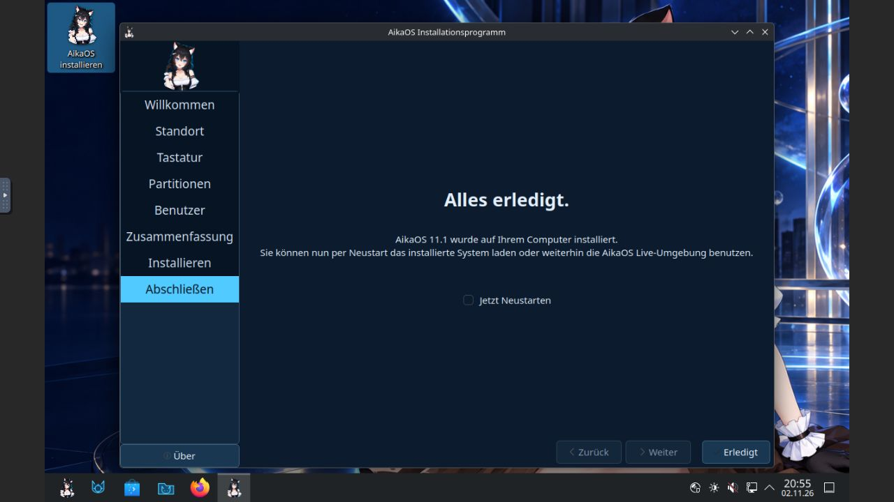
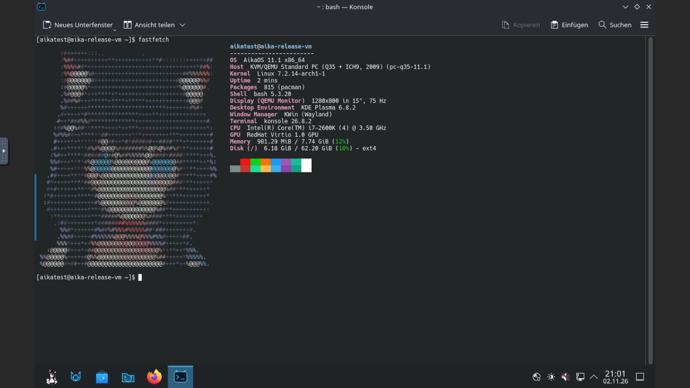

# AikaOS 11.1 final-image acceptance

## Exact release artifact

The stable-channel image was built from source commit `f07245344426639dab65dd5087df73ed202a208c` by [release workflow run 41507259888](https://github.com/emiliaplays/AikaOS/actions/runs/41507259888). Documentation-only commits after that revision do not change the tested ISO.

| Property | Value |
| --- | --- |
| Filename | `aikaos-11.1-stable-x86_64.iso` |
| Size | 2,334,775,296 bytes |
| SHA-256 | `c14421479741e7ea8de9fda50af7ea617ca451ac38f869bf36078e4710f00116` |
| OS identity | AikaOS 11.1, stable channel |
| Linux package | `7.2.14.arch1-1` |
| Plasma / KWin | `6.8.2-1` |
| Calamares | `3.4.3-4` |
| Fastfetch | `2.70.0-1` |
| AMD / Intel microcode packages | `20261019-1` / `20260925-1` |

The downloaded ISO matched its SHA-256 sidecar and build manifest. GitHub CLI verification passed both against GitHub's attestation API and against the downloaded provenance bundle, enforcing the exact source revision, the repository's `build-release-image.yml` workflow and a GitHub-hosted runner. The ISO, checksum sidecar, build manifest and package inventory all matched the attested subject digests.

Exact metadata and the provenance bundle are preserved in [releases/11.1](../releases/11.1/). Build checks covered stable OS/installer identity, boot assets, Fastfetch, the German keyboard preview and preserved microcode payloads.

## Final installation acceptance

On 2026-11-02, this exact ISO completed a fresh QEMU 11.1.3/KVM installation with four virtual CPUs, 8 GiB RAM, a new 64 GiB qcow2 disk and a separate UEFI variable store. No physical disk or host-folder passthrough was used. Its checksum was verified again on the VM host before boot.

The live desktop reached Plasma and the desktop **Install AikaOS** icon opened the stable-branded installer. German keyboard preview, Europe/Berlin, the empty `/dev/vda` target and **Erase disk → Use a swap file** were checked in the GUI. The installer held its process-lifetime sleep inhibitor. All **33 installation jobs completed successfully**, including `mkswap`, regenerated initramfs images, UEFI GRUB and fallback-loader installation.

The VM was shut down and relaunched without the installer ISO. Password login through SDDM reached Plasma Wayland. The separate diagnostic CD was unmounted/ejected after starting a temporary key-only diagnostic service; QMP confirmed that all virtual CD drives were empty. Normal SSH autostart remained disabled.

| Installed check | Observed result |
| --- | --- |
| Acceptance, including swap checks | **29/29 passed** |
| Extended installed-system audit | **11/11 passed** |
| Root filesystem | `/dev/vda2`, ext4; no Archiso boot parameters |
| Stable identity / running kernel | AikaOS 11.1 / `7.2.14-arch1-1` |
| Swap file | 536,870,912 bytes, `root:root`, mode `0600` |
| Automatic swap activation | Active on the first installed boot, without manual `swapon` |
| Usable swap / unit | 536,866,816 bytes / generated `swapfile.swap` active |
| Machine identity | Fresh installed machine ID, different from the live session |
| Account/default cleanup | Password login/sudo, root locked, live user/defaults and installer removed |
| Boot files | Kernel, initramfs, Intel/AMD microcode images and Aika GRUB present |
| Network and user files | DNS, HTTPS, package consistency and user write/read/fsync round trip passed |
| Current failed units / guest coredumps | None in the system or user manager / none |
| Desktop | Fastfetch Aika portrait, Firefox HTTPS page, password lock/unlock passed |
| Installed shutdown | VM process had exited before the first subsequent host poll |

The Fastfetch configuration retained the supplied SHA-256, and no desktop graphics environment overrides were added. The main `plasma-ksplash.service` reported success with exit status 0. GUI password unlock changed the session from `LockedHint=yes` to `no` and returned to the usable desktop.

## Retained observations and limits

The logs are not warning-free. `findmnt --verify` returned zero parse errors/errors with one regular-file swap-source warning. The kernel's error-level output contained the old host CPU's unsupported-TDX message. Optional desktop integrations logged missing services, and Discover's PackageKit notifier could not load its backend library; graphical Arch package management is outside this release's supported path. A transient D-Bus-activated KSplash unit also logged an exit-code result, despite the main splash service succeeding and no failed units remaining at audit time.

The live-session shutdown delayed at the Plasma/user-manager stop timeout. Its temporary diagnostic daemon had been started from the desktop session, so this observation was confounded by the test fixture. For the installed run, the diagnostic daemon was started in a separate transient system unit (`/system.slice/aika-vm-diagnostics.service`); the installed shutdown completed before the first subsequent process poll. This is a comparison, not proof of the live delay's cause. The original trace is retained privately; no timeout, service mask or distribution graphics setting was changed to hide it.

Calamares also logged unavailable `chcon`, Qt model/layout warnings and an unset optional autologin key, while completing all installation jobs. Installed password login and disabled autologin were checked independently. Private diagnostic keys, services, account details and logs are not release-image additions.

This final ISO received VM acceptance. Physical installation, full update/reboot and S3 resume were tested on the earlier corrected development profile, not by reflashing this exact stable ISO. Wi-Fi, Bluetooth, NVIDIA, hibernation, encryption, dual boot and recovery remain outside the acceptance matrix. This test verifies automatic swap setup, not memory-pressure or hibernation behavior.

Earlier development-profile results remain separate: [Calamares swap-file installation](SWAP_VALIDATION.md), [physical installation](HARDWARE_VALIDATION.md) and [full update/reboot/suspend](UPDATE_VALIDATION.md). See [known limitations](KNOWN_ISSUES.md) for the supported scope.
