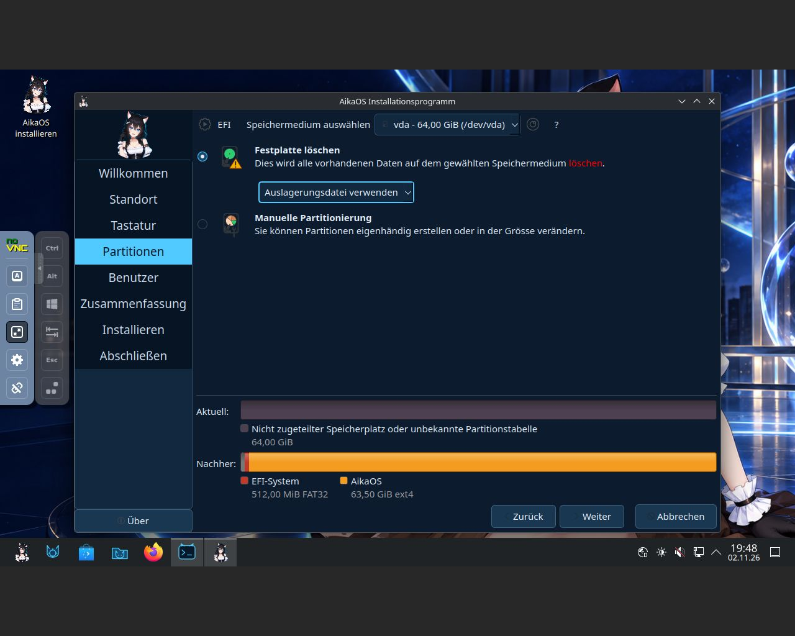
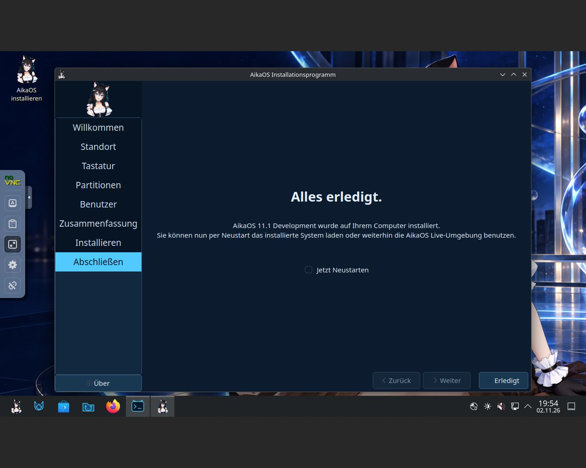

# Calamares swap-file installation validation

On 2026-11-02, the actual Calamares **Use a swap file** option was tested through a complete installation and installed-disk boot. This is distinct from the earlier disposable [runtime swap test](UPDATE_VALIDATION.md).

## Image and isolated VM

- Image source: `da8120f6ed49978433aaf4533ddfcac39ed28c1a`, AikaOS 11.1 Development.
- ISO SHA-256: `d2f0abcf3396ebc8e6ce8d3817f703b1e0c30dac1f036622a50fd6abb5effe3b`, verified again on the VM host.
- QEMU 11.1.3 with **KVM enabled**, four virtual CPUs, 8 GiB RAM and UEFI firmware with a fresh variable store.
- A new blank **64 GiB qcow2** disk, virtio display/network and an absolute USB tablet. No physical disks or host folders were passed through.
- The Linux test PC supplied KVM acceleration. A VNC console was bound to host loopback, password protected and reached through an SSH tunnel. A separate diagnostic CD contained only a public test key and a VM-restricted bootstrap.

## Installer selection and execution

The normal `install-aikaos` wrapper was opened in the live desktop. German locale/keyboard and Europe/Berlin were retained. The blank `/dev/vda` was selected, followed by **Erase disk → Use a swap file**. No partitioning option had been preselected.

The resulting layout was a 512 MiB FAT32 EFI partition and a 63.5 GiB ext4 root. A new temporary normal user was created with password-protected login and sudo. The normal final installation confirmation was accepted for this empty virtual disk.

All **33 jobs completed successfully**. The retained private log includes `mkswap` on the target's `/swapfile`, both initramfs images, UEFI GRUB and fallback loader installation, fresh machine identity/keyring and installed-default cleanup.

## Installed boot and swap results

The VM was shut down and relaunched without the installer ISO. The installed disk booted through UEFI/GRUB to the Aika SDDM login, and password authentication reached Plasma Wayland. The diagnostic CD was subsequently unmounted/ejected; QMP confirmed that all virtual CD drives were empty.

| Check | Observed result |
| --- | --- |
| Root | `/dev/vda2`, ext4; no Archiso boot parameters |
| Swap file | `/swapfile`, **536,870,912 bytes (512 MiB)** |
| Ownership/mode | `root:root`, **0600**, regular file |
| fstab | `/swapfile swap swap defaults 0 0` |
| Automatic activation | Active immediately after installed boot, before any manual swap activation |
| Active usable swap | 536,866,816 bytes, accounting for its header |
| systemd | `swapfile.swap` active, generated from fstab |
| Installation acceptance | **29/29**, including the four optional swap checks |
| Extended installed-system audit | **11/11** |
| Services/coredumps | No failed system/user services or guest coredumps |

`findmnt --verify` reported zero parse errors and zero errors, with one warning identifying the regular-file swap source. The generated swap unit and automatic activation passed. This warning is retained rather than treating the output as warning-free.

Normal SSH autostart remained disabled. Diagnostics used a separate temporary key-authenticated server in the guest's runtime directory. The live helper/key and any virtual-machine graphics settings were not copied into the distribution image.

## Desktop comparison and limits

KSplash completed successfully in both live and installed sessions, without masks or timeout changes. Meta+L displayed the Aika wallpaper and an interactive password form, and the correct password returned to the desktop (`LockedHint=yes` then `no`). The password form hides after inactivity; with active input it rendered and authenticated normally. No failed user service or coredump followed this test.

This KVM run did not reproduce the earlier TCG startup timeout or unusable unlock transition. Those earlier findings remain in the [development report](INSTALLER_VALIDATION.md); this result does not establish support for every virtual GPU or emulator configuration.

The first host QEMU startup failed while its optional Virtio graphics components were incomplete. After installing the remaining official display modules, the guest started with KVM. That host-side test-tool coredump was retained separately and was not counted as a guest/distribution crash.

This validates the offered swap-file installation path and one installed boot, not hibernation or behavior under memory pressure. The subsequent stable-channel image is a separate build; its completed acceptance pass is documented in [RELEASE_VALIDATION.md](RELEASE_VALIDATION.md).
