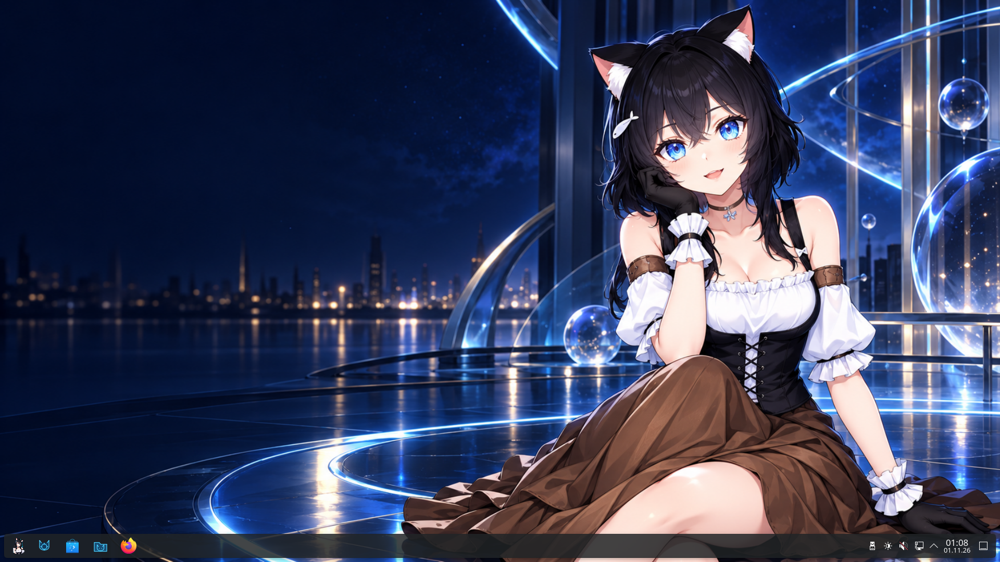

# AikaOS 11.1 Beta 1

The first public AikaOS beta brings an Arch Linux base, KDE Plasma and an Aika-themed live desktop together in one x86_64 image.

**[Download the complete ISO from SourceForge](https://sourceforge.net/projects/aikaos/files/11.1-beta.1/aikaos-11.1-x86_64-grub.iso/download)** · **[Rufus USB guide](https://github.com/emiliaplays/AikaOS/blob/main/docs/GETTING_STARTED.md)** · **[Report a bug](https://github.com/emiliaplays/AikaOS/issues/new/choose)**

The ISO is a single file: **2,325,436,416 bytes** (2.33 GB / 2.17 GiB). No split archive or reassembly is required. The ISO is hosted on SourceForge because it exceeds GitHub's per-asset release limit. The small assets below contain checksums, release metadata, validation results and the package inventory; GitHub's source archives contain the project sources, not the bootable ISO.



## Included

- KDE Plasma **6.8.2** on Wayland, with Firefox, Dolphin, Konsole, Kate and NetworkManager.
- Aika desktop and lock-screen artwork, mascot branding and selected themed icons.
- A custom Aika GRUB menu with BIOS and UEFI boot support.
- Fastfetch **2.70.0**, preconfigured with the maintainer's color ASCII Aika portrait and compact/full variants.
- Linux **7.2.11-arch1-1**. The exact package inventory is attached.

## Create a bootable USB with Rufus

1. Download the **ISO** using the SourceForge link above and verify its SHA-256 below.
2. Download **[Rufus from rufus.ie](https://rufus.ie/en/)** and connect an **8 GB or larger USB drive**.
3. In Rufus, select the intended USB under **Device**, click **SELECT**, and choose `aikaos-11.1-x86_64-grub.iso`.
4. Click **START**. If offered an ISO/DD choice, select **DD Image mode**. Writing erases the selected USB drive; check the device carefully.
5. Wait for **READY**, eject the drive, restart, and select the **UEFI USB** entry in your computer's boot menu. **Secure Boot must be disabled** for this unsigned beta.

See the [full guide](https://github.com/emiliaplays/AikaOS/blob/main/docs/GETTING_STARTED.md) for verification commands and troubleshooting.

```text
67e9a02edabc58ee082d68838499a51f7f62ecb57fc9cd4b00be749b993d405e  aikaos-11.1-x86_64-grub.iso
```

## Beta scope and known limitations

- This is a **live evaluation image**, with no persistence or graphical AikaOS installer. Changes reset after reboot. The included `archinstall` CLI does not automatically transfer the custom live desktop to an installation.
- The live session defaults to **German locale and keyboard**, with the **Europe/Berlin** timezone. Repository and release documentation are in English.
- SDDM automatically signs in as **`aika`**, with **no password** and passwordless `sudo`. Automatic screen locking is disabled. These are open live-session defaults.
- Hardware testing is limited. A successful physical live boot was reported by the maintainer. QEMU checks and full USB read-back verification are documented in [validation details](https://github.com/emiliaplays/AikaOS/blob/main/docs/VALIDATION.md); these do not establish broad hardware compatibility.
- An earlier QEMU TCG session had a KWin/Breeze crash and recovered. The final emulator checks used temporary in-memory rendering workarounds; those settings are not part of the shipped image.
- The newly published build wrapper passes static checks, but a full clean rebuild of that wrapper has not been performed. This release distributes the exact existing, tested 11.1 ISO.

Please include hardware, boot mode, reproduction steps and relevant error messages when [reporting a bug](https://github.com/emiliaplays/AikaOS/issues/new/choose).
